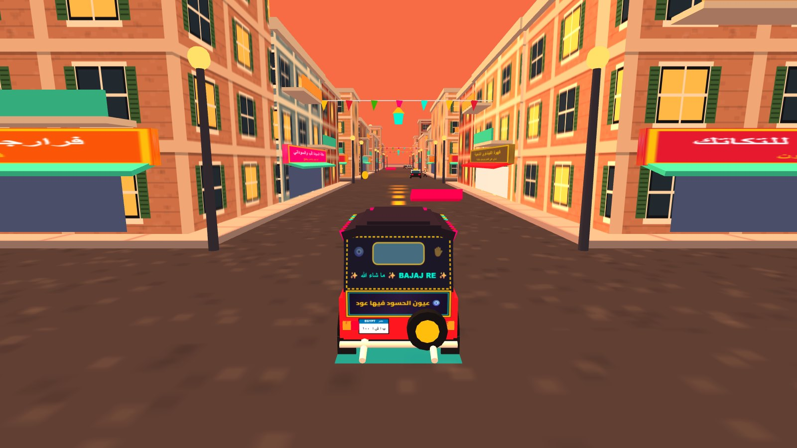
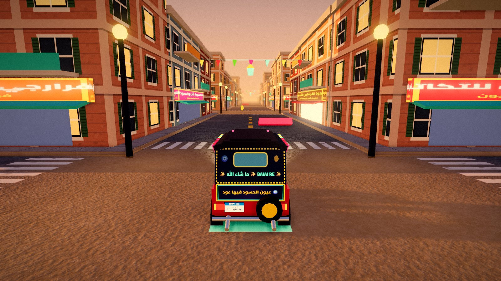
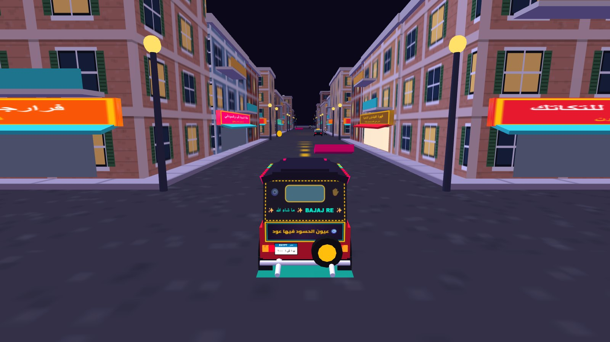
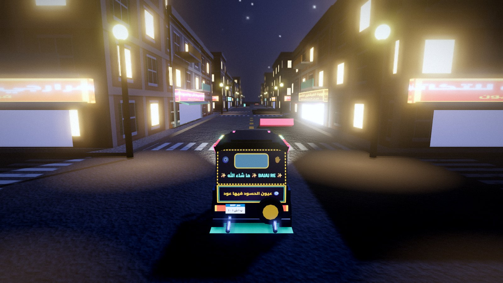

# 🛺 توكتوك باشا – سباق الحواري المصرية 🇪🇬 (TukTuk Basha 3D)

لعبة سباق أركيد ثلاثية الأبعاد (3D WebGL / Three.js) في قلب الحواري والشوارع الشعبية المصرية (شبرا • إمبابة • السيدة زينب).

## ✨ المميزات (Features)
- **مجسم توكتوك بجاج مصري أصيل 3D:** مزود بالفرنشة والشراشيب، استبن خلفي، نمر مصرية، إضاءة نيون، وحِكم شعبية على ضهر التوكتوك.
- **عمارات وشوارع مصرية ثلاثية الأبعاد:** واجهات طوب أحمر ومحارة، بلكونات وشيش خشب مجسم، تكييفات، غية حمام وأطباق دش فوق الأسطح، زينة وفوانيس رمضان، ومحلات شعبية (كشري، عصير قصب، قهوة بلدي، ورشة الأسطى عبده).
- **حركة مرور ومواقف عشوائية مضحكة:** ميكروباصات وتاكسي القاهرة بـ 4 عجلات متحركة، فراخ هربانة بتعدي الشارع 🐔، وعربية بطيخ مقلوبة 🍉.
- **صوتيات وموسيقى شعبية تفاعلية (Web Audio API):** إيقاع طبلة مقسوم ومزمار، سرينة التوكتوك الشهيرة، وتعليق صوتي مصري أصيل.
- **٥ أطوار لعب:** مشوار الباشا (Career)، سباق سريع (Quick Race)، تحدي الدليفري (Delivery Challenge)، تمشية حرة (Free Roam)، وتحدي الصحاب شاشة مقسومة (Local 2-Players).
- **دعم كامل للموبايل والكمبيوتر:** ذراع تحكم بلايستيشن تفاعلي على الشاشة (عصا أنالوج 360° `L3` + أزرار `△ ○ ✕ □`) بالإضافة للوحة المفاتيح (`WASD` / الأسهم).

## 🚀 طريقة التشغيل والنشر على GitHub Pages
1. ارفع هذا المستودع (Repository) إلى حسابك على **GitHub**.
2. من إعدادات المستودع على GitHub افتح **Settings** -> **Pages**.
3. تحت **Build and deployment (Source)** اختر **GitHub Actions** (أو **Deploy from a branch** -> `main` / `/ (root)`).
4. ستعمل اللعبة فوراً على الرابط:
   `https://<your-username>.github.io/<repo-name>/`

## 🎨 Realistic 3D graphics (Three.js r170)

The renderer runs on a vendored Three.js r170 (`vendor/three`) with a modular graphics layer in `src/gfx/`, bundled into one plain script, `dist/tuktuk.js`: PBR materials, image-based lighting, soft sun shadows, post-processing, wheel dust, skid marks and a spring-damped chase camera.

| Before (r128, Lambert) | After (High, sunset) |
|---|---|
|  |  |
|  |  |

### Quality levels

Pick a level in the main menu under **جودة الرسوم** (Auto / Low / Medium / High). The choice is saved and the page reloads to apply it. You can also force one from the URL: `?quality=low`, `?quality=medium`, `?quality=high` or `?quality=auto`.

| Level | What it enables | Picked automatically for |
|---|---|---|
| Low | PBR materials, image-based lighting, fog, contact shadows, dust and skid marks. No post-processing, no shadow maps, pixel ratio 1. | Phones and software renderers |
| Medium | Low + PCF-soft sun shadows (1024), bloom, speed blur, colour grading, vignette, film grain, clearcoat paint, headlight beam. | Laptops with integrated graphics, flagship phones |
| High | Medium + GTAO ambient occlusion, far depth of field, 2048 shadows, 4x MSAA, pixel ratio up to 2. | Desktops with a discrete GPU |

In Auto mode the render resolution is also lowered a little when the frame rate stays under the tier's target, and restored when there is headroom. Tier settings live in `src/gfx/quality.js`; `TTGfx.stats()` in the browser console prints the live FPS, draw calls and tier.

### Measured frame rate

Same 6-second drive from the spawn point, 1280x720 viewport at 1.25 pixel ratio, Intel Iris Xe (integrated), browser capped at about 144 FPS:

| Build | FPS | Median frame | Draw calls |
|---|---|---|---|
| Before (r128) | 135 | 7.2 ms | 862 |
| After, Low | 144 | 6.9 ms | 275 |
| After, Medium (auto on this machine) | 74 | 13.3 ms | 357 |
| After, High | 34 | 29 ms | 623 |

High is meant for discrete GPUs and was not measured on one. No real phone was tested: with a phone-sized viewport emulated on the same laptop, Auto picks Low and draws about 130 calls per frame.

### Regenerating assets

Every generated asset is listed in `assets/higgsfield/manifest.json` with its prompt, model and resolution; `assets/higgsfield/PROMPTS.md` is the same list in ready-to-paste form (rebuild it with `node tools/build-prompts.mjs`).

1. Generate the image in Higgsfield with the listed prompt, model and aspect ratio.
2. Save it at the listed path under `assets/higgsfield/` (WebP or JPG, 2048 px or smaller for textures).
3. Set that asset's `"status"` to `"ready"` in `manifest.json`. If you also made normal / roughness / AO maps, list them: `"extraMaps": ["normal", "roughness"]`.

Assets still marked `pending` use the procedural placeholders in `src/gfx/textures.js`, and normal and roughness maps are derived from the albedo when not supplied. The golden-hour panorama (`env_sky_golden_hour`) replaces the procedural sky in the sunset mode once it is ready. Texture ids currently used by the game: `tex_asphalt`, `tex_sidewalk`, `tex_sand`, `tex_canvas_roof`.

### Running locally

Double-click `index.html`: the game runs straight from disk. `node tools/serve.mjs 8080` (then `http://localhost:8080/`) also works.

### Editing the graphics code

`src/boot.js`, `src/gfx/` and `vendor/three/` are bundled into `dist/tuktuk.js`, which is committed so the game works from disk and on GitHub Pages without a build. It is a classic script rather than ES modules because browsers block modules on `file://`. After changing anything under `src/`, rebuild:

```bash
npm install
```

```bash
npm run build
```

`npm run watch` rebuilds on every save. The Pages workflow also rebuilds before deploying, so a forgotten rebuild cannot reach the live site. The other game scripts (`game.js`, `city.js` and so on) are not bundled and need no build.
